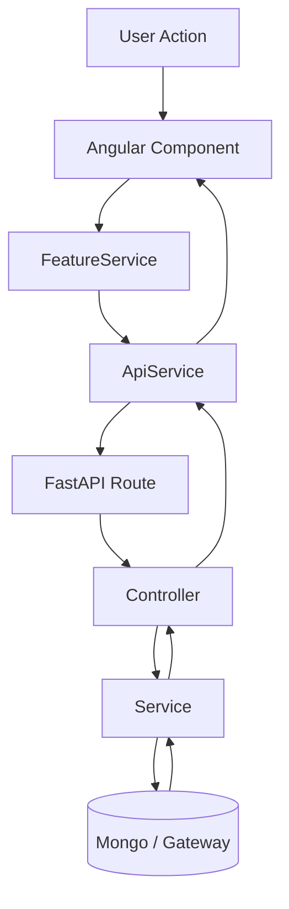

# Explain End-to-End Flow

Explain the requested functionality as an end-to-end flow using the actual TILA implementation. READ-ONLY.

## Rules

- Trace from start to finish using real source.
- Do not invent steps.
- For each step: trigger, what happens, data in/out, file, symbol, next step.

## Mermaid

Always include a Mermaid flowchart with real component/file names.

Only include layers that participate.
