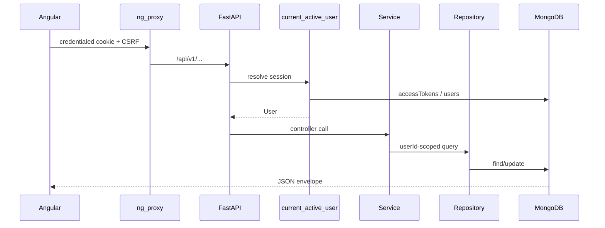

# Data flows

End-to-end flows agents should trace before changing Auth, Documents, RAG, or Chat.

## Authenticated API request



Protected routes depend on Auth. Changing cookie/CSRF/session strategy affects every protected endpoint and the Angular auth interceptors. See [../modules/auth.md](../modules/auth.md) and [dependency-map.md](dependency-map.md).

## Document upload → ingest (target)

```text
Web upload
  → POST /api/v1/documents (auth required)
  → DocumentService creates record (status UPLOADING/PROCESSING)
  → StorageService stores bytes
  → enqueue document.ingest job
  → Worker: extract → chunk → embed → vector store
  → status READY or FAILED
```

Details: [../modules/documents.md](../modules/documents.md), [jobs.md](jobs.md). Do not run full ingest inside the request handler beyond enqueue.

## RAG query → answer (target)

```text
User question (chat)
  → embed query
  → vector similarity search (scoped by userId / notebookId)
  → context builder
  → LLMService.generate (app/ai/gateway only)
  → assistant message persisted
```

Details: [../modules/rag.md](../modules/rag.md), [../modules/chat.md](../modules/chat.md), [ai-architecture.md](ai-architecture.md), [ADR-0001](../decisions/ADR-0001-llm-gateway-canonical.md).

## Ownership rule on every flow

User-owned reads/writes filter by `userId` from the authenticated principal. Never trust a client-supplied owner id alone. Auth collections are the FastAPI Users exception ([persistence.md](persistence.md)).
