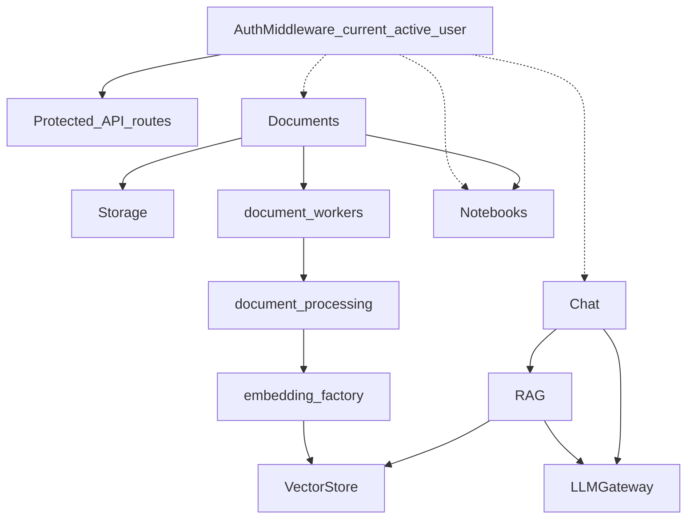

# Dependency map

Blast-radius guide for agents. Refresh import hints with:

```bash
python3 scripts/scan-api-imports.py
```

Generated edges: [dependency-map.generated.md](dependency-map.generated.md) (do not edit by hand).

Defer Import Linter / Pydeps / Madge / Dependency Cruiser until listed as a closed gap in `docs/brain/gaps.md`.

## Module graph



## Nodes

### Auth / AuthMiddleware

| | |
|--|--|
| **Status** | partial (MVP) |
| **Owners** | FastAPI Users wiring, `app/dependencies/auth.py`, cookie/CSRF middleware, `Web` auth services/guards |
| **Dependents** | Every protected API route; Angular credentialed HTTP |
| **Module doc** | [../modules/auth.md](../modules/auth.md) |
| **Breaking change checklist** | Cookie name/path/secure; CSRF header; session strategy; login identifier; CORS origins; FE interceptors/guards |

### Notebooks

| | |
|--|--|
| **Status** | scaffold |
| **Owners** | `notebook_*` layers under `API/app`, `Web/features/notebook` |
| **Dependents** | Documents, Chat (via `notebookId`) |
| **Module doc** | [../modules/notebooks.md](../modules/notebooks.md) |
| **Breaking change checklist** | Delete cascade; ownership field rename; list indexes |

### Documents / Storage / DocWorker

| | |
|--|--|
| **Status** | scaffold |
| **Owners** | `document_*`, `app/storage/`, `app/workers/` |
| **Dependents** | RAG ingest, Chat (document-scoped) |
| **Module doc** | [../modules/documents.md](../modules/documents.md) |
| **Breaking change checklist** | Storage key format; status enum; worker payload shape; orphan blobs |

### RAG / Processing / EmbedFactory / VectorStore

| | |
|--|--|
| **Status** | scaffold |
| **Owners** | `app/ai/rag/`, embeddings, vectorstores, document_processing, factories |
| **Dependents** | Chat grounded answers |
| **Module doc** | [../modules/rag.md](../modules/rag.md) |
| **Breaking change checklist** | Embedding model/dimensions → re-ingest; chunking params; vector index layout; never bypass LLM gateway for generation |

### Chat

| | |
|--|--|
| **Status** | scaffold |
| **Owners** | conversation/message layers, chat feature UI |
| **Dependents** | Learning features later |
| **Module doc** | [../modules/chat.md](../modules/chat.md) |
| **Breaking change checklist** | Message role enum; thread ownership; streaming contract; gateway error mapping |

### LLMGateway

| | |
|--|--|
| **Status** | implemented |
| **Owners** | `app/ai/gateway/` |
| **Dependents** | Chat, RAG answer path, diagnostic `/llm` |
| **ADR** | [../decisions/ADR-0001-llm-gateway-canonical.md](../decisions/ADR-0001-llm-gateway-canonical.md) |
| **Breaking change checklist** | Provider interface; retry/fallback semantics; attempt log shape; do not revive `app/ai/llm/*` |

## Agent rule

When `/MakePlan` touches Auth middleware, gateway, embeddings, workers, or shared core, cite this file (and the generated import edges) under **Dependencies and Impact**.
