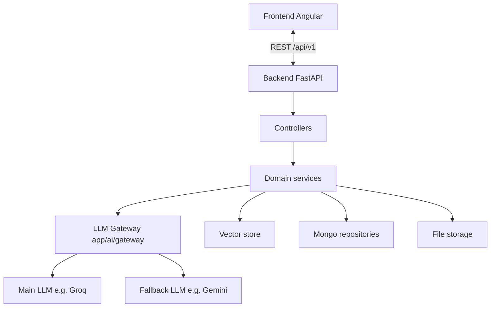

# Architecture

## High-level



## Stack

| Layer | Choice |
|-------|--------|
| Frontend | Angular 18 standalone, Tailwind, TypeScript |
| Backend | Python 3.12, FastAPI, uvicorn |
| App DB | MongoDB (Motor) |
| Vector | Chroma / FAISS (via factories; not wired yet) |
| LLM | `app/ai/gateway` with main + fallback providers |
| Dev runner | `npm run dev` (concurrently: uvicorn + ng serve) |

## Backend request flow

```text
Router (app/api/v1)
  → Middleware
  → Controller
  → Service
  → Repository
  → MongoDB
```

AI calls leave services only through `app/ai/gateway` (or factories for embeddings / vector stores / loaders).

## Frontend shape

```text
src/app/
  core/       guards, interceptors, models, shared API/auth services
  features/   auth, notebook, document, chat, quiz, dashboard, landing, settings
  layout/     navbar, sidebar, footer
  shared/     reusable components, pipes, directives
```

## RAG (target)

**Ingestion:** upload → storage → extract → clean → chunk → embed → vector DB → update status.

**Query:** question → embed → vector search → context → LLM → answer.

Document ingestion is expensive; design for background workers (see [jobs.md](jobs.md)). Request/ingest/RAG/chat flows: [data-flow.md](data-flow.md).

## LLM gateway

Canonical door: `app/ai/gateway`. Retryable errors retry the same provider; permanent errors skip to fallback. Diagnostic routes: `GET/POST /llm` and `/api/v1/llm`. Details: [ai-architecture.md](ai-architecture.md), [../archive/TILA.Architecture.md](../archive/TILA.Architecture.md).

## Dependency direction

```text
api → controllers → services → repositories → core/database
                 ↘ app/ai/gateway
                 ↘ app/factories (embeddings, vector, loaders, chunkers)
```

Forbidden:

- Controllers with business logic
- Services importing FastAPI request/response types for domain work
- Direct Mongo access outside repositories
- New LLM client code outside `app/ai/gateway`
- Frontend components calling `HttpClient` directly (use `ApiService` / feature services)

## Dev ports

| Process | Port |
|---------|------|
| API | 8000 |
| Angular | 4200 (proxies `/api` and `/llm` to 8000) |
